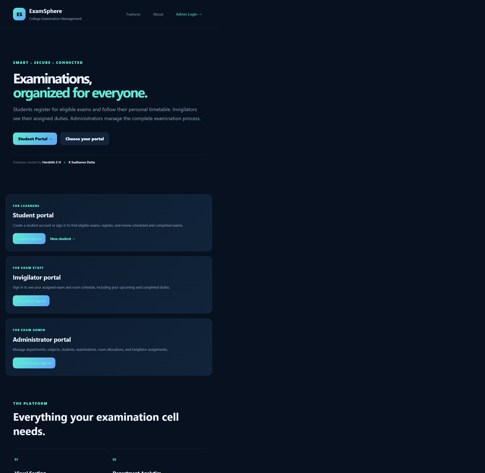
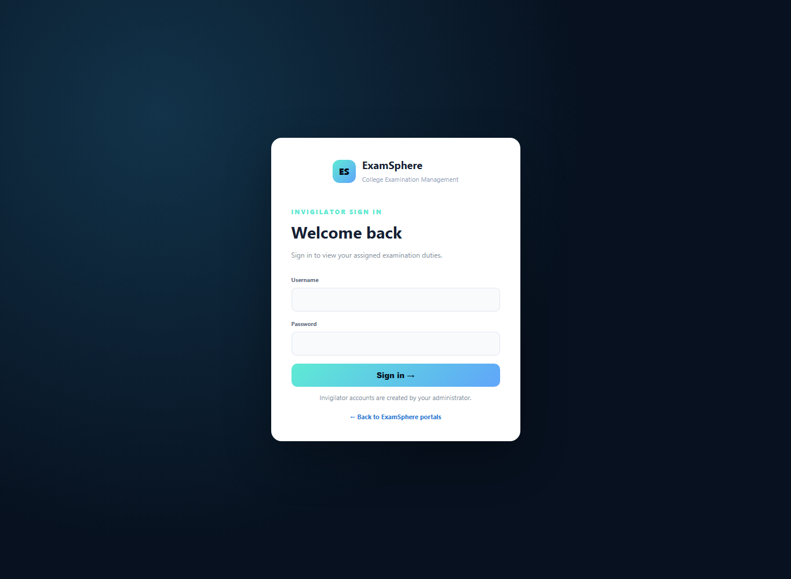
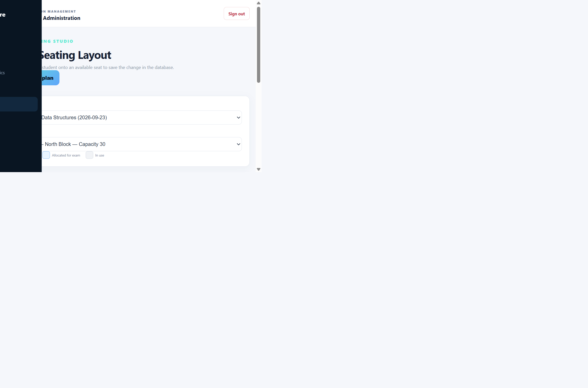
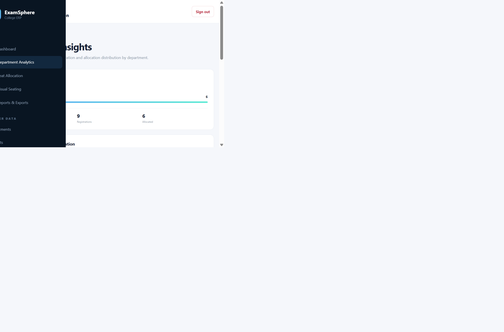
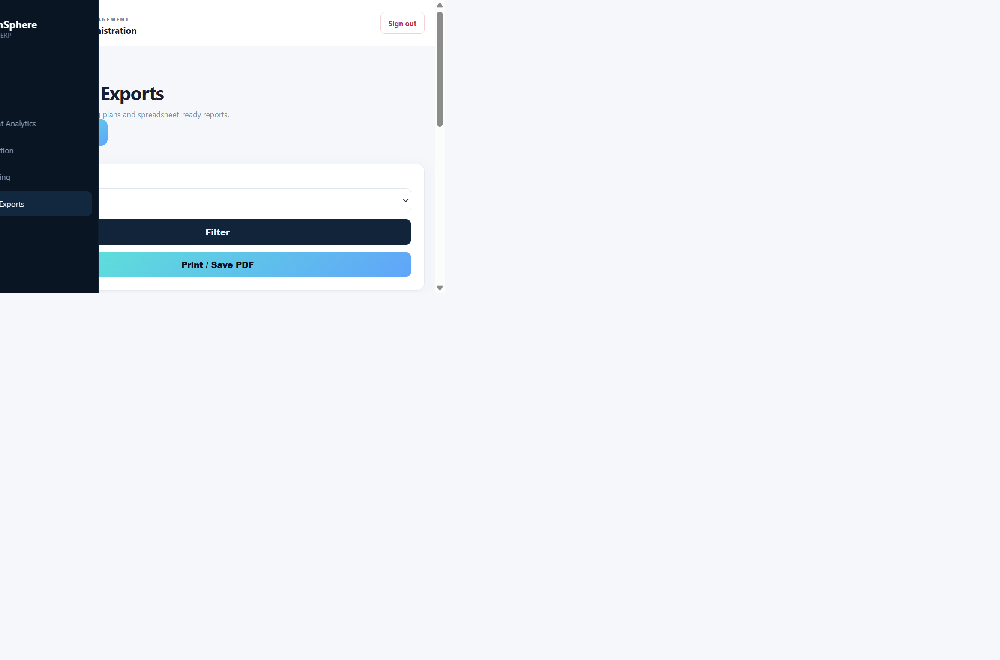

# ExamSphere — College Examination Management

## Project Report

**Project:** ExamSphere College Edition  
**Project type:** Web-based college examination management system  
**Authors credited in the application:** Harshith S H and K Sudhanva Datta

## 1. Introduction

ExamSphere is a web application for coordinating college examination activities. It brings examination administration, student registration, room and seat allocation, invigilator scheduling, analytics, and report generation into one system.

The application provides separate entry points for administrators, students, and invigilators. Administrators maintain the examination data and seating plans; eligible students can register for published examinations and view their schedules; invigilators can view their assigned duties.

## 2. Objectives

- Centralize examination-related academic and operational records.
- Provide role-specific access for administrators, students, and invigilators.
- Let administrators manage departments, subjects, students, exams, rooms, and invigilator assignments.
- Enforce student eligibility when registering for an examination.
- Assign seats manually or automatically while checking room capacity and seat availability.
- Present seating plans visually and allow administrators to move assigned students to free seats.
- Summarize examination activity by department and provide printable and spreadsheet-friendly reports.

## 3. Project Architecture

ExamSphere follows a server-rendered, PHP application architecture backed by a relational database:

```text
Administrator / Student / Invigilator
                  |
                  v
    Browser: HTML forms and page views
                  |
                  v
 PHP page controllers and shared templates
 (role sessions, authorization, validation)
                  |
                  v
        PDO database access layer
                  |
                  v
     MySQL / MariaDB relational schema
```

### Main layers and modules

1. **Presentation:** PHP templates render pages and forms. CSS provides the responsive layouts, and JavaScript supports interface behavior such as seat drag-and-drop.
2. **Application logic:** Individual PHP pages handle sign-in, role-specific portals, master-data management, registration, allocation, analytics, and exports. Shared files provide database setup, sessions, authorization, escaping, and CSRF helpers.
3. **Data:** MySQL or MariaDB stores linked records. The schema models departments, subjects, students, examinations, rooms, registrations, room allocations, invigilators, duties, and user accounts.
4. **Outputs:** The report center renders seating data for printing and produces CSV and Excel-compatible downloads.

### Core data relationships

- A department can have subjects and students.
- A subject belongs to a department and can have examinations.
- Students register for examinations through `EXAM_REGISTRATION`.
- A registration can have a room and seat assignment in `ROOM_ALLOCATION`.
- Invigilators are assigned to examinations and rooms through `INVIGILATOR_DUTY`.
- User accounts can be linked to student or invigilator profiles.

Foreign keys and uniqueness constraints protect these relationships; for example, a student may register only once for an examination, and a room-seat pair cannot be allocated more than once.

## 4. Implementation

### Authentication and access

The application has separate sign-in flows for each role. Server-side role checks protect the corresponding pages, and role-specific PHP sessions keep portal identities separate. Forms that make changes use CSRF tokens; database operations use PDO, and rendered data is HTML-escaped.

### Administration

The administrator dashboard summarizes key records and upcoming examinations. The management interface supports create, search, edit, and delete operations for the supported academic and examination tables. Department analytics aggregates student, subject, registration, and allocation totals.

### Student and invigilator portals

Students can create an account linked to a generated student profile and see examinations relevant to their department and current semester. The server checks that an examination is published, upcoming, eligible, and not already registered before accepting registration. The student portal separates scheduled registrations from completed exam history and displays seat details when available.

Invigilators see upcoming and completed duties assigned to their own linked profile, including examination time and room information.

### Seating and reporting

Administrators can allocate seats manually or automatically. Both allocation paths check the room's available capacity and occupied seats; automatic allocation leaves existing assignments in place and fills free seats. The visual seating page displays available, allocated, and otherwise occupied seats, and supports moving a student to an available seat.

The report center filters seating records by examination and supports browser printing, CSV downloads, and Excel-compatible downloads.

## 5. Tech Stack Used

| Area | Technology |
|---|---|
| Server-side application | PHP 8+ |
| Database | MySQL 8+ or MariaDB |
| PHP database access | PDO with the MySQL driver |
| Front end | HTML, CSS, and vanilla JavaScript |
| Local development | XAMPP or PHP's built-in web server with MySQL/MariaDB |
| Report formats | Browser print / Save as PDF, CSV, and Excel-compatible `.xls` |

## 6. Demo Images

These screenshots were captured from the application served locally at `http://127.0.0.1:8000/`.

### 6.1 Public home page and portal choices



### 6.2 Student sign-in


### 6.3 Invigilator sign-in



### 6.4 Administrator dashboard


### 6.5 Visual seating plan



### 6.6 Department analytics



### 6.7 Reports and exports



### Verification note

All PHP pages passed syntax checks. The local application connected to MySQL and displayed existing records on the administrator dashboard (10 students, 5 examinations, 4 rooms, and 8 seat allocations). The administrator dashboard, visual seating page, department analytics, and report center rendered with database-backed content. Student and invigilator sign-in pages also rendered; their authenticated workflows were not exercised in this verification.

## 7. Conclusion

ExamSphere provides a unified starting point for managing college examination data and workflows. Its role-specific portals, relational data model, eligibility checks, seat allocation tools, analytics, and export options address the key needs of examination administrators, students, and invigilators. The local verification confirmed that administrative views and reports render from the connected database; exercising the complete student and invigilator workflows remains a useful next step.
