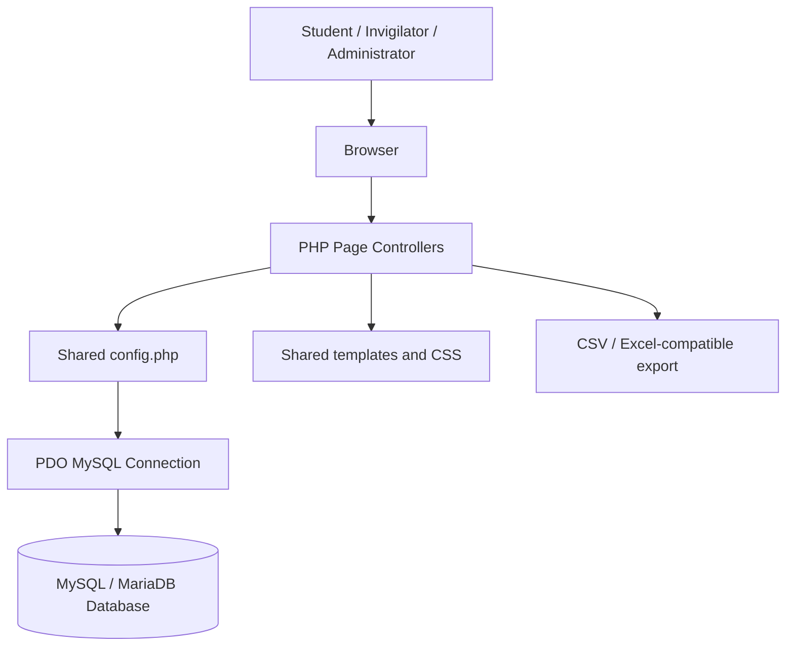
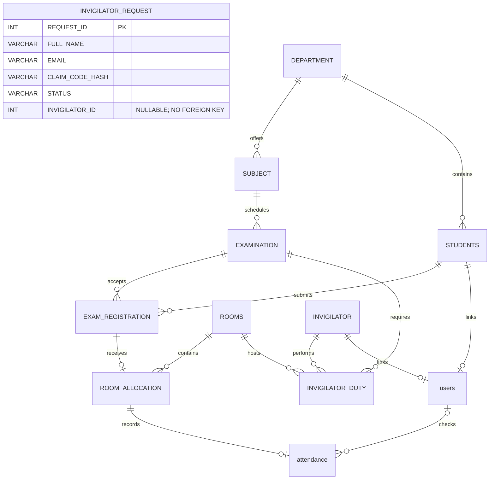
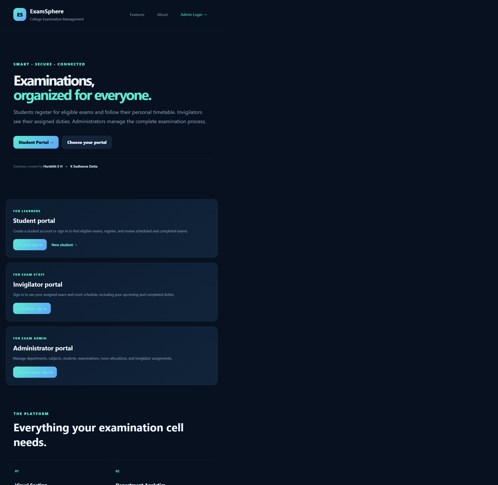
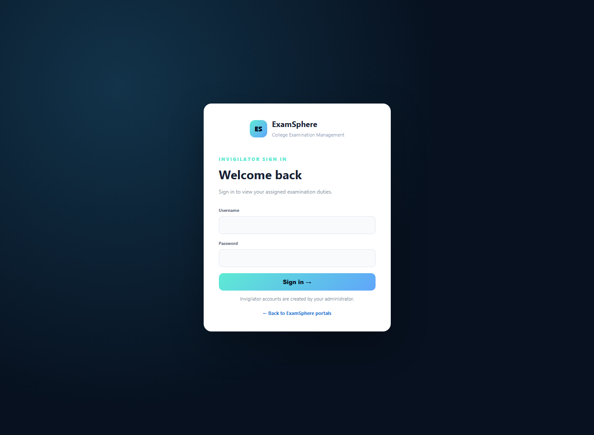
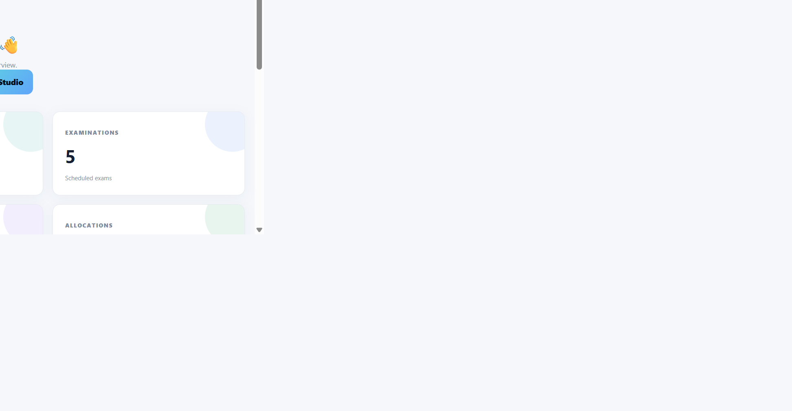
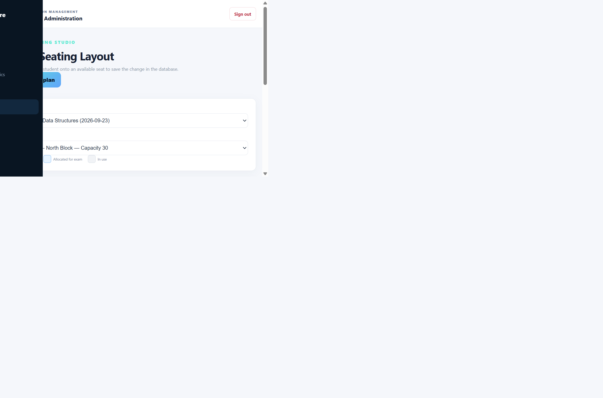
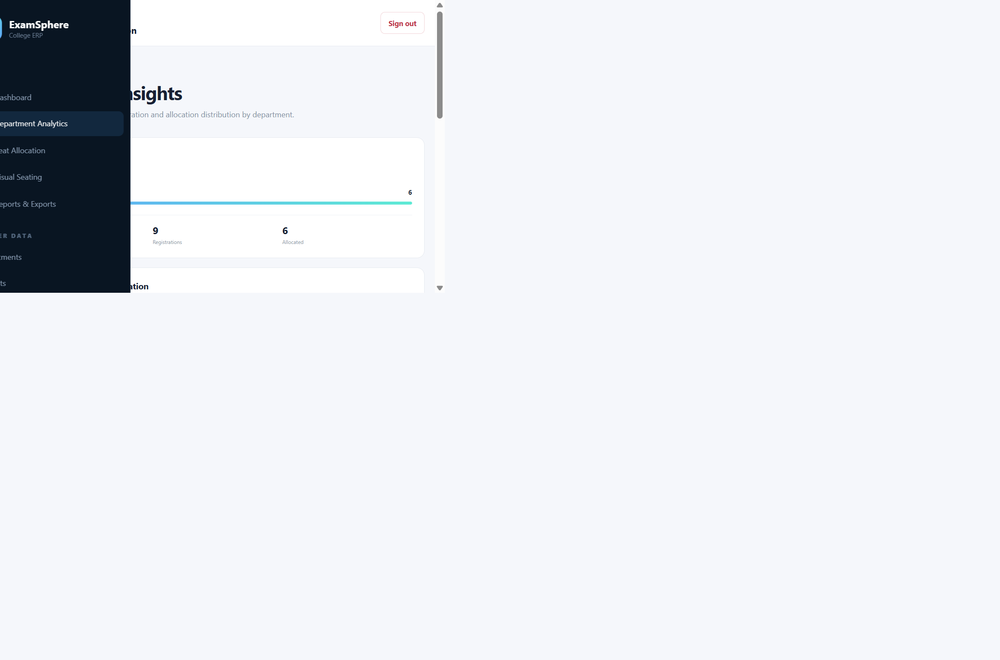
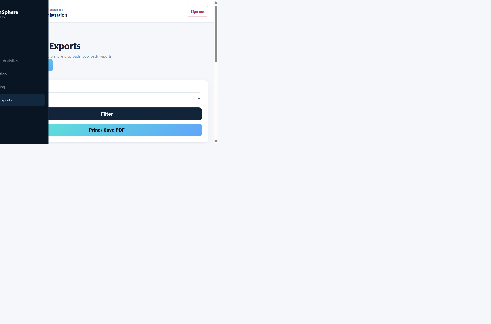
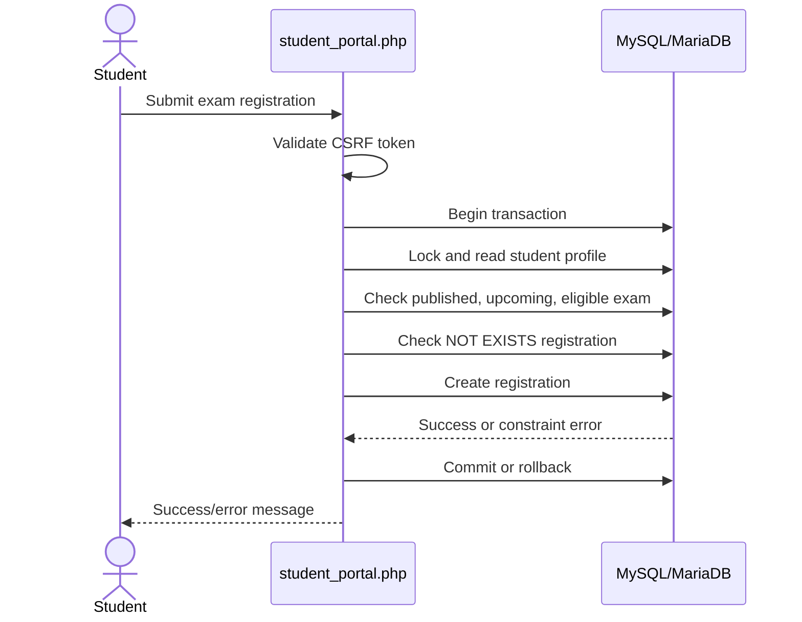
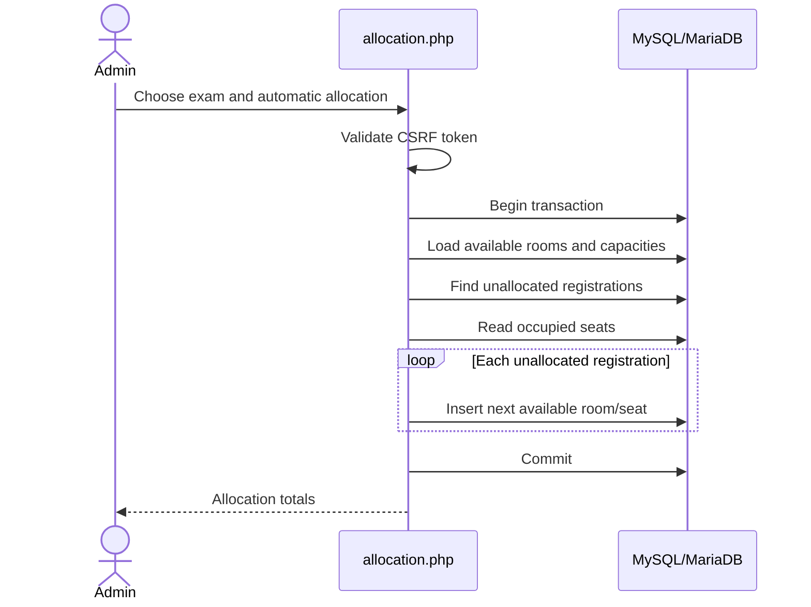

# ExamSphere — College Edition

## Detailed Project Report

**Project type:** Web-based college examination management system
**Technology:** PHP 8+, MySQL 8+/MariaDB, PDO, HTML, CSS, vanilla JavaScript
**Application style:** Server-rendered, role-based web application
**Project authors credited in the application:** Harshith S H and K Sudhanva Datta
**Report date:** 1 November 2026

---

## 1. Executive Summary

ExamSphere — College Edition is an examination-management web application designed to coordinate the activities of students, invigilators, and examination administrators. The system centralizes academic master data, examination scheduling, student registration, room allocation, seat planning, invigilator duties, analytics, and report exports in one relational application.

The application is implemented as a PHP/PDO web application backed by MySQL or MariaDB. It uses a normalized relational schema containing departments, subjects, students, examinations, rooms, exam registrations, room allocations, invigilator duties, application users, and administrator users. Foreign keys, unique constraints, transactions, CSRF tokens, role-based sessions, prepared statements, and output escaping are used to protect data integrity and separate responsibilities between user types.

The public landing page provides access to three portals. Students create accounts and register only for published upcoming examinations that match their department and semester. Invigilators see only the duties assigned to their own linked profile. Administrators manage master data and examination operations, including manual and automatic seat allocation, visual seating changes, analytics, and printable/CSV/Excel-compatible reports.

The project also contains a protected administrator SQL Lab. The SQL Lab runs fixed, read-only queries and demonstrates right joins, MySQL-compatible full outer join emulation, cross joins, self joins, `COUNT`, `SUM`, `AVG`, `MIN`, `MAX`, `GROUP BY`, and `HAVING` against the live database.

Overall, the project is a strong academic demonstration of a relational examination system and role-based CRUD application. Before production deployment, it should receive additional hardening around credential management, login rate limiting, concurrency-safe identifier generation, database error handling, automated testing, and deployment configuration.

---

## 2. Problem Statement

Colleges commonly manage examination information across disconnected spreadsheets, paper records, messaging applications, and manually prepared seating plans. This creates several operational problems:

- Student, subject, department, examination, and room data may become inconsistent.

- Students may register for examinations for which they are not eligible.

- Seat assignments can be duplicated or exceed room capacity.

- Invigilators may not have a centralized view of their duties.

- Administrators may spend significant time preparing seating reports manually.

- Historical and department-level examination information is difficult to summarize.

- Deleting a master record can leave dependent records orphaned unless relationships are handled carefully.

ExamSphere addresses these problems by representing the examination process as a connected relational workflow. The database becomes the authoritative source for eligibility, registration, allocation, duty assignment, and reporting.

---

## 3. Objectives

The project objectives are:

1. Provide a centralized platform for college examination administration.

1. Maintain departments, subjects, students, examinations, rooms, and invigilators in a relational database.

1. Provide separate portals for administrators, students, and invigilators.

1. Allow students to create accounts and register for eligible examinations.

1. Prevent duplicate registrations and invalid department/semester registrations.

1. Assign examination seats manually or automatically while respecting capacity and occupancy rules.

1. Provide a visual seating layout with drag-and-drop seat movement.

1. Manage invigilator duties by examination and room.

1. Provide department analytics using joined aggregate SQL queries.

1. Generate printable seating reports and CSV/Excel-compatible exports.

1. Demonstrate a broad range of SQL joins and aggregate functions through the administrator SQL Lab.

1. Preserve referential integrity through foreign keys, unique constraints, validation, and transactions.

---

## 4. Scope of the System

### 4.1 Included scope

The current implementation includes:

- Public landing page and portal selection.

- Administrator login and dashboard.

- Student registration and student login.

- Invigilator login.

- Role-specific sessions.

- CRUD management for core administrative tables.

- Department deletion with related-record cleanup.

- Student and invigilator linked account management.

- Invigilator access requests, administrator approval/rejection, and account claim.

- Examination registration from the student portal.

- Manual room allocation.

- Automatic room allocation.

- Visual seat map and seat movement.

- Invigilator duty viewing.

- Attendance marking by assigned invigilators after an examination starts.

- Department analytics.

- Printable reports.

- CSV and Excel-compatible output.

- SQL join and aggregate demonstrations.

### 4.2 Out-of-scope or optional areas

The following areas are not implemented as complete modules:

- Email, SMS, or push notifications are not implemented.

- Online payment, fee management, marks, grading, and result publication are not implemented.

- Multi-college or multi-campus tenancy is not implemented.

- A formal automated test suite is not included.

- There is no background job system for notifications or scheduled maintenance.

---

## 5. System Architecture

ExamSphere follows a server-rendered layered architecture.



### 5.1 Presentation layer

The presentation layer consists of PHP templates, HTML forms, CSS, and a small amount of vanilla JavaScript. The administrator interface uses a fixed sidebar and shared layout in `partials.php` and `end.php`. Student and invigilator portals use `portal_header.php` and `portal_footer.php`.

The visual design uses a dark blue administrative interface, responsive layout rules, dashboard cards, panels, tables, status badges, forms, and separate portal styling.

### 5.2 Application layer

Each major feature is implemented as a PHP page controller. The controllers:

- Start the correct role session.

- Enforce authorization.

- Read request values.

- Validate values.

- Execute prepared statements or fixed SQL queries.

- Commit or roll back transactions where required.

- Render the appropriate view.

Important controllers include:

| File | Responsibility |
| --- | --- |
| `index.php` | Public landing page and database status summary |
| `login.php` | Shared authentication entry point |
| `student_register.php` | Student profile and account creation |
| `student_portal.php` | Student eligibility, registration, and timetable |
| `invigilator_register.php`, `invigilator_requests.php` | Invigilator applications, administrator review, and account claim workflow |
| `invigilator_portal.php` | Invigilator duty schedule, history, and attendance marking |
| `dashboard.php` | Administrator overview and counts |
| `manage.php` | Generic administrator CRUD controller |
| `allocation.php` | Manual and automatic seat allocation |
| `seating.php` | Visual seating plan and seat moves |
| `analytics.php` | Department-level joined aggregate analytics |
| `reports.php` | Printable seating report |
| `export.php` | CSV and Excel-compatible export |
| `sql_lab.php` | Live read-only join and aggregate demonstrations |

### 5.3 Data layer

The data layer uses PDO with the MySQL driver. The connection is configured centrally in `config.php`. PDO is configured with exception-based error handling, associative fetch mode, and native prepares (`PDO::ATTR_EMULATE_PREPARES` is disabled).

### 5.4 Output layer

The application renders:

- Interactive HTML pages.

- Printable seating reports.

- CSV files.

- Excel-compatible HTML tables with an `.xls` download response.

- Live tabular SQL Lab results.

---

## 6. Database Design

The fresh-install schema creates the `exam_room_allocation_system` database.

### 6.1 Main tables

| Table | Purpose | Key relationships |
| --- | --- | --- |
| `DEPARTMENT` | Academic department master data | Parent of `SUBJECT` and `STUDENTS` |
| `SUBJECT` | Subjects offered by departments and semesters | Belongs to `DEPARTMENT`; parent of `EXAMINATION` |
| `STUDENTS` | Student profiles | Belongs to `DEPARTMENT`; parent of registrations |
| `EXAMINATION` | Examination schedule | Belongs to `SUBJECT`; parent of registrations and duties |
| `ROOMS` | Examination rooms and capacities | Parent of allocations and duties |
| `INVIGILATOR` | Invigilator master data | Parent of duties |
| `EXAM_REGISTRATION` | Student-to-examination registrations | Links `STUDENTS` and `EXAMINATION` |
| `ROOM_ALLOCATION` | Assigned room and seat for a registration | Links registration to room |
| `INVIGILATOR_DUTY` | Invigilator assignment by exam and room | Links exam, invigilator, and room |
| `users` | Student, invigilator, and optional unified application accounts | Optionally links to student/invigilator profiles |
| `attendance` | Present/absent attendance against an allocated seat | Links to a room allocation and optionally the user who checked it |
| `INVIGILATOR_REQUEST` | Invigilator access applications and review status | Stores a nullable approved invigilator ID; the schema does not declare this as a foreign key |
| `ADMIN_USERS` | Separate administrator authentication table | Stores administrator credentials |

### 6.2 Relationship model



`INVIGILATOR_REQUEST.INVIGILATOR_ID` records the profile created on approval, but the fresh-install schema does not define a foreign-key constraint for that column.

### 6.3 Integrity constraints

The database design applies several important constraints:

- Primary keys identify every core entity.

- Foreign keys enforce valid parent records.

- `UNIQUE(STUDENT_ID, EXAM_ID)` prevents duplicate student registration for an examination.

- `UNIQUE(REGISTR_ID)` in `ROOM_ALLOCATION` ensures a registration receives at most one allocation.

- `UNIQUE(ROOM_ID, SEAT_NO)` prevents a room/seat pair from being assigned more than once globally under the supplied schema.
- `UNIQUE(attendance.allocation_id)` allows at most one attendance record per seat allocation.
- Attendance status is constrained to `present` or `absent`.

- Unique usernames prevent duplicate account names.

- Student and invigilator profile links in `users` are unique.

- Administrator usernames are unique.

- The `users.role` check constraint limits roles to `admin`, `student`, and `invigilator`.

### 6.4 Important schema behavior

The current schema treats a room/seat pair as globally occupied across examinations because `ROOM_ALLOCATION` uses `UNIQUE(ROOM_ID, SEAT_NO)`. The seating page therefore displays a seat used by another examination as blocked. If the intended business rule is that the same physical seat may be reused for different examinations at different times, the uniqueness rule should instead include the examination context, likely through a constraint or indexed design involving the registration/examination relationship.

---

## 7. Functional Module Analysis

### 7.1 Public landing page

`index.php` provides:

- Application branding.

- Portal selection cards.

- Links to student, invigilator, and administrator entry points.

- A database online/offline indicator.

- Live counts of students, rooms, and examinations.

- A feature overview covering visual seating, analytics, role-based portals, and reports.

If the database connection fails, the landing page catches the exception and displays an offline state rather than terminating with a raw database error.

### 7.2 Authentication and sessions

`login.php` is the shared authentication controller. It first checks the administrator table and then checks the unified `users` table. Student and invigilator login pages set a requested role and reuse the shared controller.

The authentication flow includes:

1. Role validation against the allowed roles.

1. Username lookup using a prepared statement.

1. Password verification using PHP password hashing.

1. Compatibility verification for older `pbkdf2_sha256` hashes.

1. Transparent password rehashing when an older hash succeeds.

1. Linked-profile validation for student and invigilator accounts.

1. Role-specific session names.

1. Session ID regeneration after successful authentication.

1. Redirect to the correct portal.

Role-specific session names allow administrator, student, and invigilator sessions to remain separate in different tabs or contexts. `require_role()` and `require_admin()` protect server-side pages; the application does not rely only on hiding links in the interface.

### 7.3 Student registration

`student_register.php` creates a student profile and a linked login account in one transaction.

Validation includes:

- Department must exist.

- Semester must be between 1 and 12.

- First and last names are required.

- Name fields have length limits.

- Username length is limited to 60 characters.

- Password must contain at least 8 characters.

- Duplicate usernames are rejected.

The student ID is obtained from the database auto-increment value. The student record and linked `users` record are committed together; a failure rolls back the transaction.

### 7.4 Student portal and examination registration

`student_portal.php` separates three student activities:

1. Scheduled examinations.

1. Completed examination history.

1. Eligible examinations available for registration.

An examination is eligible only when:

- It is published.

- Its date/time has not passed.

- Its subject belongs to the student’s department.

- Its offered semester matches the student’s current semester.

- The student is not already registered.

The registration POST path uses a CSRF token, starts a transaction, locks the student row with `FOR UPDATE`, rechecks eligibility, generates a registration ID, inserts the registration, and commits. This server-side recheck is important because client-side lists alone cannot prevent stale or manipulated requests.

The portal also joins examination, subject, department, registration, room allocation, and room data so the student can see a seat when one has been assigned.

### 7.5 Administrator dashboard

`dashboard.php` displays counts for students, examinations, rooms, allocations, invigilators, registrations, and departments. It also lists upcoming examinations using joins from examination to subject and department.

The room summary uses conditional aggregation:

```sql
SELECT
    COUNT(*) AS total,
    SUM(CASE WHEN STATUS = 'AVAILABLE' THEN 1 ELSE 0 END) AS available
FROM ROOMS;
```

Quick actions lead to master-data management, allocation, analytics, reports, and the SQL Lab.

### 7.6 Generic administration and CRUD

`manage.php` is the main administrator data-management controller. Instead of duplicating CRUD code for every table, it maintains an allowlisted table-to-column configuration.

Supported administrative tables include:

- Departments.

- Subjects.

- Students.

- Examinations.

- Rooms.

- Invigilators.

- Exam registrations as a read-only view.

- Room allocations.

- Invigilator duties.

Features include:

- Search across the configured columns.

- Create records.

- Edit records.

- Delete records.

- Foreign-key dropdowns populated from valid parent records.

- Automatic student ID handling.

- Linked portal account creation for students and invigilators.

- Read-only treatment of student-owned exam registrations.

- Foreign-key blocker reporting on failed deletes.

For department deletion, the controller gathers related students, subjects, examinations, registrations, allocations, attendance rows, duties, and linked user accounts. It then deletes related data inside a transaction and displays a deletion report showing counts and affected identifiers.

### 7.7 Manual and automatic allocation

`allocation.php` provides two allocation modes.

**Manual mode:**

- Validates the selected examination and registration.

- Confirms the room is available.

- Checks the seat is within room capacity.

- Checks the room/seat pair is not occupied.

- Inserts a room allocation.

**Automatic mode:**

- Loads available rooms and their capacities.

- Selects registrations that are not already allocated using a `LEFT JOIN` and `IS NULL` condition.

- Tracks occupied seats.

- Finds the next available numbered seat.

- Preserves existing assignments.

- Reports how many registrations were allocated and how many could not be seated.

Both modes use transactions and validation before writing data.

### 7.8 Visual seating studio

`seating.php` presents a selected room as a visual seat grid. Each seat is classified as:

- Available.

- Allocated for the selected examination.

- Blocked because it is in use under the database’s global room-seat rule.

Assigned seats are draggable. When an assigned student is dropped onto a free seat, a hidden form submits the allocation, examination, room, seat, and CSRF token. The server then validates room capacity, confirms the allocation still belongs to the selected exam and room, checks for seat conflicts, and updates the seat number.

The page also supports printing the room plan.

### 7.9 Invigilator portal

`invigilator_portal.php` loads duties only for the authenticated invigilator ID. It joins duty, examination, subject, department, and room records to show:

- Examination date.

- Subject.

- Department.

- Start and end time.

- Room, building, and floor.

- Scheduled versus completed status.

Completed status is calculated from the examination date and end time. The portal does not expose other invigilators’ duties.

Invigilators first submit an access request. An administrator can approve or reject pending requests. Approval creates an invigilator profile; the applicant can then claim it using the one-time request code and choose sign-in credentials. Once signed in, an assigned invigilator can record `present` or `absent` for students allocated to their room after the examination starts. Attendance is linked to the seat allocation and appears in student history and administrator summaries.

### 7.10 Analytics

`analytics.php` provides department-level insights. It uses a chain of `LEFT JOIN`s from department to students, subjects, examinations, registrations, and allocations. The query uses `COUNT(DISTINCT ...)` to avoid inflated counts caused by one-to-many joins.

The displayed metrics are:

- Students per department.

- Subjects per department.

- Registrations connected to the department.

- Allocated seats connected to those registrations.

- Allocation rate calculated in PHP.

Using `LEFT JOIN` ensures departments with no dependent records can still appear in the results.

### 7.11 Reports and exports

`reports.php` produces a printable seating report by joining allocation, registration, examination, subject, department, student, and room information. It can show all exams or filter by a selected examination.

`export.php` supports:

- CSV downloads.

- Excel-compatible `.xls` output using an HTML table.

- Optional examination filtering.

- Spreadsheet formula-injection protection by prefixing values beginning with formula characters such as `=`, `+`, `-`, or `@`.

- HTML escaping in the generated Excel-compatible table.

### 7.12 SQL Lab

`sql_lab.php` is an administrator-only, read-only page. It runs fixed SQL statements and renders their result sets dynamically.

The page demonstrates:

- `RIGHT JOIN` between rooms and allocations.

- Full outer join behavior using two `LEFT JOIN` queries combined by `UNION ALL`, because MySQL does not directly implement `FULL OUTER JOIN`.

- `CROSS JOIN` between departments and rooms.

- A self join comparing two room aliases in the same building.

- `AVG`, `MIN`, and `MAX` grouped by building.

- `COUNT`, `COUNT(DISTINCT ...)`, `AVG`, `MIN`, and `MAX` across multiple joined tables.

- `GROUP BY` and `HAVING`.

The page uses no user-supplied SQL and performs no insert, update, delete, or schema operation.

---

## 8. SQL Usage and Coverage

The application uses several categories of SQL.

### 8.1 Join coverage

| Join or technique | Project usage |
| --- | --- |
| Inner join | Examinations with subjects; reports; portals; allocations |
| Left join | Unallocated registration detection; analytics; student timetable |
| Right join | SQL Lab room/allocation demonstration |
| Full outer join behavior | SQL Lab `UNION ALL` emulation |
| Cross join | SQL Lab department/room planning combinations |
| Self join | SQL Lab same-building room comparisons |
| `NOT EXISTS` | Student eligibility and duplicate-registration prevention |
| `FOR UPDATE` | Transactional student and registration checks |
| `UNION ALL` | Full outer join emulation |

### 8.2 Aggregate coverage

| Function/clause | Project usage |
| --- | --- |
| `COUNT` | Dashboard counts, record counts, analytics |
| `COUNT(DISTINCT)` | Department analytics and joined SQL Lab summary |
| `SUM` | Available room conditional count |
| `AVG` | SQL Lab room capacity summaries |
| `MIN` | SQL Lab minimum room capacities |
| `MAX` | Next-ID logic and SQL Lab maximum capacities |
| `GROUP BY` | Department analytics and SQL Lab reports |
| `HAVING` | SQL Lab filtered aggregate summaries |

The SQL Lab makes the less frequently used academic examples visible in the website rather than leaving them only in a standalone SQL file.

---

## Website Screenshots

The following screenshots were captured from the local ExamSphere website and illustrate the principal user-facing pages. The image files are retained in the project’s `demo_images` folder so the report can be distributed together with the source code.

### 1. Public landing page

The landing page introduces ExamSphere, displays the database status and summary counts, and provides entry points for the student, invigilator, and administrator portals.



### 2. Student sign-in

The student sign-in page provides role-specific access and links new students to the registration workflow.


### 3. Invigilator sign-in

The invigilator sign-in page provides access to the authenticated staff duty portal.



### 4. Administrator dashboard

The administrator dashboard summarizes students, examinations, rooms, and allocations, and provides quick actions for the main operational modules.




### 5. Visual seating studio

The visual seating page represents a room as a seat grid and distinguishes available, allocated, and blocked seats.



### 6. Department analytics

The analytics page displays department-level student, subject, registration, and allocation summaries generated through joined aggregate SQL queries.



### 7. Reports and exports

The reports page displays the examination seating report and provides print, CSV, and Excel-compatible export actions.



---

## 9. Security and Data Integrity Review

### 9.1 Positive controls

The source demonstrates several good security and integrity practices:

- Role checks are performed server-side.

- Prepared statements are used for most user-controlled values.

- Table and column names in the generic controller come from allowlists.

- CSRF tokens protect state-changing forms.

- Session IDs are regenerated after authentication.

- Output is escaped through the `e()` helper.

- Passwords are stored using `password_hash()` for new accounts.

- Legacy password hashes are upgraded after successful login.

- Foreign keys enforce valid relationships.

- Unique constraints prevent duplicate usernames, registrations, and room-seat allocations.

- Transactions protect multi-step registration, allocation, and deletion operations.

- Exported spreadsheet values are checked for formula injection.

- Student and invigilator portals are restricted to linked profiles.

### 9.2 Security and operational risks

The following issues should be addressed before production use:

1. **Credential defaults:** Development database defaults and the demo administrator account are present in project configuration/documentation. Production deployments should use environment variables, rotate all credentials, and remove demo credentials from the login UI.

1. **Login rate limiting:** There is no visible account lockout, IP throttling, CAPTCHA, or progressive delay after repeated failed logins.

1. **Error disclosure:** Some administrator error paths include database exception messages in flash messages. These are useful during development but should be logged server-side and replaced with safer user-facing messages in production.

1. **Generated examination and duty identifiers:** Student, invigilator, registration, and allocation numeric identifiers use auto-increment columns in the current schema. Examination and duty IDs are generated in application code; concurrent creation of equivalent IDs should be covered by tests, with database uniqueness constraints serving as the final integrity check.

1. **Input validation breadth:** The application validates many lengths and numeric values, but production deployments should add stronger username character rules, email validation, date/time consistency checks, and business rules such as `END_TIME > START_TIME`.

1. **Database user privileges:** The application should connect using a restricted database account rather than a highly privileged local root account.

1. **HTTPS and cookie configuration:** Deployment should enforce HTTPS and secure, HttpOnly, and SameSite session-cookie settings.

1. **CSRF coverage review:** State-changing forms already include CSRF tokens, but every future administrative endpoint should preserve the same pattern.

1. **Existing-database migrations:** The fresh-install schema includes `attendance` and `INVIGILATOR_REQUEST`. The attendance/invigilator-approval migration remains an upgrade script for older databases and should be run only after reviewing its preflight checks.

1. **Concurrency testing:** Allocation and registration paths should be tested under simultaneous requests.

---

## 10. Transaction and Workflow Analysis

### 10.1 Student registration workflow



### 10.2 Automatic allocation workflow



### 10.3 Department deletion workflow

The department deletion logic is deliberately more comprehensive than a single `DELETE` statement. It identifies dependent students, subjects, examinations, registrations, allocations, attendance rows, duties, and linked user accounts. It deletes in dependency-safe order, commits as one operation, and presents a report of deleted records.

This is useful for an academic project because it demonstrates transaction boundaries, dependency discovery, foreign-key-aware cleanup, and user feedback after destructive operations.

---

## 11. Deployment and Installation

The README describes the following local deployment process:

1. Start MySQL/MariaDB through XAMPP or another local service.

1. Import `db_setup.sql` or the clean schema into the database server.

1. Import `auth.sql` to create the administrator authentication table and demo account.

1. Configure the database connection through environment variables or `config.php`.

1. Ensure PHP has the `pdo_mysql` extension enabled.

1. Serve the project through Apache or PHP’s built-in server.

1. Open the application landing page.

For existing databases:

- Run `student_id_autoincrement_migration.sql` if existing student records require auto-generated IDs for future registrations.

- Review and run only the migrations required to upgrade the existing schema. If both attendance/invigilator approval and cascade deletion upgrades are needed, run `attendance_invigilator_approval_migration.sql` before `cascade_delete_migration.sql`.

- Back up the database before running migrations.

Use the root-level `db_setup.sql` and `auth.sql` as the fresh-install schema sources. Supplemental schema and ER artifacts under `outputs` are reference materials and may not include the latest application tables.

---

## 12. Testing and Verification Status

### 12.1 Existing verification evidence

The existing project report states that:

- PHP pages passed syntax checks in the original verification environment.

- The local application connected to MySQL.

- The administrator dashboard rendered existing records.

- The visual seating page, analytics page, report center, and authentication pages rendered.

### 12.2 Verification performed during this review

The source review confirmed:

- All major PHP controllers and SQL scripts are present.

- The schema defines the core entities and foreign keys.

- The administrator SQL Lab contains fixed read-only queries.

- The SQL Lab contains the missing join types and aggregate functions requested for the project.

- The SQL Lab is linked from the administrator sidebar and dashboard.

- The README documents the SQL Lab and standalone SQL demonstration file.

PHP CLI syntax validation was not available in the current terminal environment because the `php` executable was not installed or exposed on the terminal PATH. The application should therefore be validated in the project’s XAMPP/PHP runtime before final submission.

### 12.3 Recommended test cases

| Area | Test case | Expected result |
| --- | --- | --- |
| Login | Valid admin credentials | Administrator dashboard opens |
| Login | Invalid password | Generic authentication error |
| Authorization | Student opens admin page | Redirect to the correct student portal/login |
| Registration | Student chooses wrong department exam | Registration rejected |
| Registration | Student registers twice | Second registration rejected |
| Registration | Expired exam submission | Registration rejected |
| Allocation | Seat exceeds capacity | Allocation rejected |
| Allocation | Duplicate room/seat | Allocation rejected |
| Allocation | Automatic allocation with insufficient capacity | Partial result clearly reported |
| Seating | Move to free seat | Seat updated |
| Seating | Move to occupied seat | Update rejected |
| Delete | Delete department with dependencies | Transactional cleanup and report |
| Analytics | Department with no students | Department remains visible through `LEFT JOIN` |
| Reports | Filter by examination | Only selected exam appears |
| Export | Export value begins with `=` | Formula-safe output is generated |
| SQL Lab | Empty table | Successful empty-state message |
| SQL Lab | Missing optional table | One example is isolated without breaking the page |
| Security | CSRF token omitted | State-changing request rejected |

---

## 13. Strengths of the Project

1. **Clear role separation:** The three portals map naturally to real examination responsibilities.

1. **Strong relational modeling:** Academic and operational relationships are represented explicitly.

1. **Practical workflow coverage:** The project goes beyond CRUD by including eligibility, allocation, seating, duty viewing, analytics, and exports.

1. **Good use of database constraints:** Unique keys and foreign keys prevent several classes of inconsistent data.

1. **Transaction-aware mutations:** Registration, allocation, and complex deletion flows use transaction boundaries.

1. **Reusable administration controller:** `manage.php` avoids duplicating CRUD code for every master table.

1. **Accessible reporting:** Printable and spreadsheet-compatible outputs are useful for examination staff.

1. **Educational SQL coverage:** The SQL Lab connects database theory to visible, live website functionality.

1. **Responsive interface:** The CSS includes responsive behavior for the dashboard, portals, forms, and seating layout.

1. **Legacy compatibility consideration:** The password verification path supports older PBKDF2 hashes and can upgrade them after login.

---

## 14. Limitations and Recommended Improvements

### 14.1 Immediate improvements

- Add concurrency-focused tests and collision handling for application-generated examination and duty IDs.

- Move all production credentials to environment variables and remove demo credentials from public screens.

- Add login throttling and account lockout policies.

- Validate examination date and time consistency.

- Add a consistent production error-handling layer that logs technical details without displaying them.

- Install PHP CLI or add XAMPP’s PHP executable to PATH for repeatable syntax checks.

- Add automated tests for authorization, registration, allocation, and deletion.

### 14.2 Medium-term improvements

- Extend attendance analytics and reporting, including exports and audit history.

- Add examination capacity planning and registration counts to the dashboard.

- Add conflict detection for overlapping examinations and invigilator duties.

- Add pagination for large management tables; the current management view limits visible rows to 200.

- Add audit logs for changes to students, exams, allocations, and deletions.

- Add export options for analytics and department summaries.

- Add database indexes based on production query plans.

- Add a formal migration/versioning system rather than standalone one-off scripts.

### 14.3 Long-term improvements

- Introduce a service/repository layer to separate SQL from HTML controllers.

- Add a REST or JSON API for mobile and integration clients.

- Add notification services for registration confirmation and seat publication.

- Add monitoring, backups, structured logs, and health checks.

- Add automated CI checks for PHP syntax, SQL migrations, security scanning, and browser smoke tests.

- Support multiple institutions or campuses if the system is deployed beyond one college.

---

## 15. Conclusion

ExamSphere — College Edition successfully demonstrates a complete college examination-management workflow in a PHP/MySQL environment. Its architecture is understandable, its core entities are modeled relationally, and its modules reflect realistic examination-cell operations.

The system’s most important capabilities are the separation of administrator, student, and invigilator responsibilities; eligibility-aware student registration; transaction-backed room allocation; visual seat management; invigilator duty display; department analytics; and printable/exportable reporting.

The addition of the SQL Lab strengthens the project academically. It makes the missing SQL concepts visible inside the website and demonstrates right joins, full outer join emulation, cross joins, self joins, and the major aggregate functions without changing operational workflows or allowing destructive SQL execution.

For an academic submission, the project provides a strong foundation for explaining database normalization, foreign-key relationships, joins, aggregation, transactions, authentication, authorization, and practical web application design. For production deployment, the next priorities should be secure configuration, concurrency-safe identifier generation, rate limiting, centralized error handling, migrations, and automated testing.

---

## Appendix A — File and Module Inventory

| Category | Files |
| --- | --- |
| Configuration | `config.php` |
| Public entry | `index.php` |
| Authentication | `login.php`, `student_login.php`, `invigilator_login.php`, `logout.php`, `auth.sql` |
| Student | `student_register.php`, `student_portal.php` |
| Invigilator | `invigilator_portal.php` |
| Administration | `dashboard.php`, `manage.php`, `allocation.php`, `seating.php`, `analytics.php`, `reports.php`, `export.php`, `sql_lab.php` |
| Shared templates | `partials.php`, `portal_header.php`, `portal_footer.php`, `end.php` |
| Schema | `db_setup.sql`, `outputs/examsphere_schema.sql` |
| Migrations | `cascade_delete_migration.sql`, `student_id_autoincrement_migration.sql` |
| SQL education | `sql_joins_aggregates_demo.sql`, `sql_lab.php` |
| Front end | `assets/style.css`, `assets/portal.css`, `assets/workflow.css`, `assets/app.js` |
| Documentation | `README.md`, `PROJECT_REPORT.md` |

## Appendix B — Demonstration Credentials and Deployment Warning

The local development materials include a demo administrator account. This is useful for classroom demonstration, but it must be changed or removed before any public, shared, or production deployment. Database credentials should be supplied through environment variables or a protected server configuration and should not be committed to a public repository.
